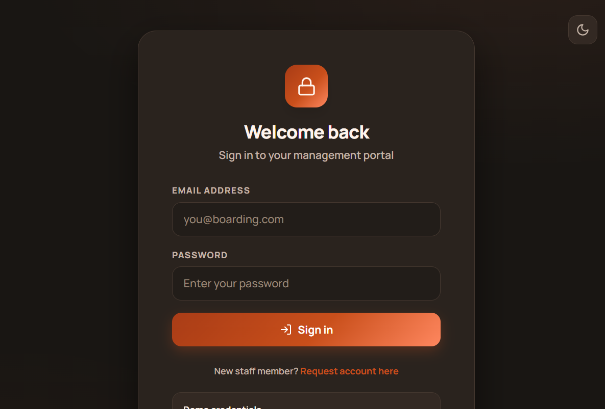
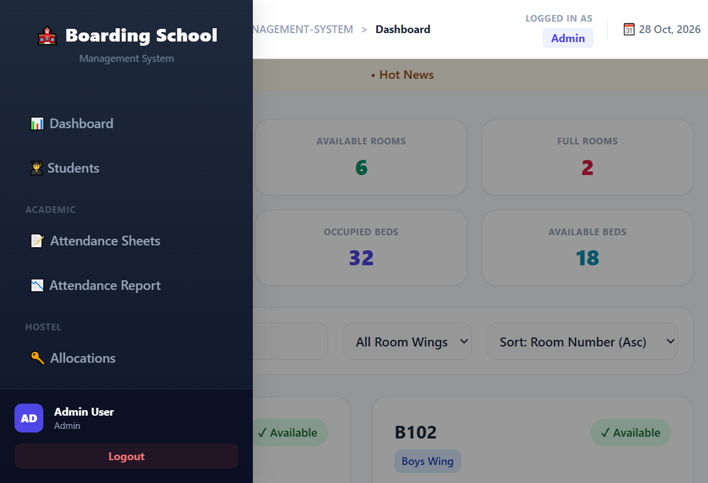

# Boarding Hotel Management System

A native PHP 8 + MySQL (MySQLi) web application for managing boarding students in an
institutional hostel/dormitory: admissions, room & bed allocation, meal records,
payments, complaints, leave management, attendance, notices and staff administration.

No framework is used — plain PHP templates with Tailwind (CDN), so the codebase is
easy to host on any shared server, XAMPP, or the PHP built-in server.

**Stack honesty note:** the application code is **procedural Core PHP** using
mysqli's *object-style API* (`$conn->prepare(...)`). There is no custom OOP layer,
no framework, and no Composer dependency — what you see is plain, readable PHP.

## Screenshots

| Login | Dashboard |
|-------|-----------|
|  |  |

## Features

| Module | What it does |
|--------|--------------|
| **Auth** | Login/logout/register, per-session CSRF tokens, role-based sessions |
| **Students** | Admission CRUD, guardians, status tracking |
| **Allocations** | Allocate / deallocate beds; transaction-safe with row locks; auto-syncs bed status and room bed counters |
| **Payments** | Monthly fee invoices; `Paid / Partial / Due` status computed server-side; duplicate invoice prevention |
| **Meals** | Daily meal records per student (Breakfast/Lunch/Dinner), quantity & serving tracking |
| **Complaints** | Student/hostel complaints; routing to Admin or Hostel Supervisor; status workflow (Open → In Progress → Resolved/Rejected) |
| **Leaves** | Leave types, applications, approval workflow, student leave balances |
| **Notices** | Bulletin-board notices with publish dates |
| **Attendance** | Student attendance records |
| **Reports** | Aggregated reports for admins |
| **Settings / Users / Staff** | Admin-only: system settings, staff user provisioning, role changes |

### Roles

| Role | Access |
|------|--------|
| **Admin** | Everything: settings, users, staff, all modules |
| **Teacher** | Students CRUD, meals, overview, reports |
| **Hostel Supervisor** | Students CRUD, allocations, meals, complaints |
| **Accountant** | Payments, reports |

All state-changing POST handlers enforce both a CSRF token check and the role gate
above; requests without a valid session token are rejected with **HTTP 403**.

## Requirements

- PHP **8.0+** (developed and tested on 8.2) with the **mysqli** extension
- MySQL 5.7+ / MariaDB 10.3+
- A browser (frontend uses Tailwind via CDN)

## Installation

### 1. Get the code

```bash
git clone https://github.com/shahed-hassan-fq-rabbi/Boarding-Hotel-Management-System.git
cd Boarding-Hotel-Management-System
```

### 2. Create the database

Import `boarding_school.sql` into MySQL. Either via phpMyAdmin in XAMPP, or:

```bash
mysql -u root -p -e "CREATE DATABASE IF NOT EXISTS boarding_school CHARACTER SET utf8mb4;"
mysql -u root -p boarding_school < boarding_school.sql
```

> The importer machine must have a MySQL client available; inside a full XAMPP
> bundle it lives at `C:\xampp\mysql\bin\mysql.exe`.

### 3. Configure credentials

Edit [`db.php`](db.php) lines 7–13 if your MySQL differs from the defaults:

```php
$servername = "localhost";
$username   = "root";
$password   = "";
$database   = "boarding_school";
```

### 4. Serve the app

**Option A — PHP built-in server (no Apache/XAMPP needed):**

```bash
php -S localhost:8080
```

**Option B — Apache/XAMPP:**

Copy the whole project folder into `htdocs` (e.g. `htdocs/boarding-hotel`) and open
`http://localhost/boarding-hotel/`. Or point an Apache alias/vhost at the folder
directly.

`BASE_URL` is **auto-detected** at runtime (both code paths in `db.php`), so the app
works unchanged at docroot root, in any subfolder, or behind a mapped alias/vhost —
no constants to edit when you deploy.

### 5. Log in

| Role | Email | Password |
|------|-------|----------|
| Admin | `admin@boarding.com` | `admin123` |

> **Change this password immediately in any real deployment.**
> (Demo credentials seeded by `boarding_school.sql`.)

## Testing credentials / sample data

The SQL dump ships with sample students, rooms and beds so all module pages render
immediately after import. Resetting to a clean slate = re-importing
`boarding_school.sql` (this is destructive to in-app changes only).

## Security model

- **CSRF:** every form embeds a per-session token from `includes/csrf.php`; all POST
  requests are centrally rejected by `includes/auth_check.php` (timing-safe
  `hash_equals`) when the token is missing/invalid.
- **RBAC:** role enumeration `student-db.user` → `enum('Admin','Teacher','Hostel
  Supervisor','Accountant')`; `include base` → `requireRoles()` gates every handler
  *before any output*, so redirects can't be bypassed; destructive handlers also
  verify roles locally.
- **Prepared statements:** all DB inputs use bound parameters; `bind_param` type
  strings matched to variables across the codebase.
- **Payment integrity:** client-sent `payment_status` is ignored; status is always
  recomputed from `amount_paid` vs. gross, and negative/over-discount payments are
  rejected.
- **Allocation integrity:** room allocate/deallocate run inside
  `START TRANSACTION` + `SELECT ... FOR UPDATE` locks; `room_beds.status` and
  `hostel_rooms.allocated_beds`/`status` are re-synced automatically.
- **Upload hardening:** student photos are validated before anything touches the
  database — extension whitelist (jpg/jpeg/png/webp/gif), 2 MB cap, a real-image
  check (`getimagesize`), and randomised filenames (the original client filename
  is never used). Files land in `uploads/`, which is git-ignored.

## Testing

The repo ships with a runnable, self-cleaning test suite in [`tests/`](tests/README.md)
— **52 checks total**, written in the same plain-PHP style as the app:

```bash
php tests/e2e_test.php          # 31 checks: auth, CSRF 403s, RBAC, allocation lifecycle, payment math
php tests/crud_test.php         # 14 checks: meals, complaints, leaves, notices, settings, users
php tests/upload_test.php       #  7 checks: photo upload security (valid image, .php & oversize rejected)
php tests/bind_params_check.php # static: bind_param type-string vs variable count across the codebase
```

Suites run against a live instance (XAMPP Apache or `php -S`) and exit `1` on any
failure, so they are CI-friendly. They only mutate throwaway rows that they delete
afterwards. Current status: **52/52 checks PASS** against XAMPP Apache + MySQL 8
on the developer machine.

## Project structure

```
auth/            login, logout, register
components/      shared layout partials (sidebar, head)
includes/        db bootstrap helpers, csrf, auth_check (CSRF + RBAC gate)
students/        admissions CRUD + guardians
allocations/     room/bed allocation engine
payments/        fee invoices
meals/           meal records
complaints/      complaint intake & resolution
leaves/          leave applications & approvals
notices/         bulletin board
attendance/     attendance module
reports/         admin reports
settings/ staff/ users/   admin-only configuration
tests/           runnable regression suites (52 checks, CLI-only)
db.php           DB connect + dynamic BASE_URL
boarding_school.sql   full schema + seed data
docs/            progress tracker, known issues, screenshots
uploads/         user-uploaded files (git-ignored, created at runtime)
```

## Deployment (free hosting — InfinityFree)

The app has zero Composer dependencies and its largest PHP file is ~40 KB, so any
PHP 8.x + MySQL shared host works. A free InfinityFree account (checked Oct 2026:
PHP 8.4, MySQL 8.0/MariaDB 11.4, 5 GB, no ads, free subdomain + SSL) is enough for
a portfolio demo. Its limits that matter: 50,000 hits/day, no email sending (this
app doesn't need it), no cron, and accounts need a visit every 30 days to stay active.

1. Create a free account at infinityfree.com and pick a free subdomain.
2. In the client panel → **MySQL Databases**: create a database; note the host
   (`sqlXXX.infinityfree.com`), database name, user and generated password.
3. Open the panel's **phpMyAdmin** → select the new database → *Import* → upload
   `boarding_school.sql`.
4. Upload the project files (File Manager or FTP, 1 FTP account on free) into
   `htdocs/` — either at the root or a subfolder; `BASE_URL` auto-detects both.
5. Copy `config.local.example.php` to `config.local.php` in the project root on the
   server and fill in the credentials from step 2 (`config.local.php` is
   git-ignored — real credentials never enter Git). Environment variables
   `DB_HOST`/`DB_USER`/`DB_PASS`/`DB_NAME` work too.
6. Make sure `uploads/students/` exists and is writable (the app creates it on
   first photo upload; chmod 775 via the file manager if your host needs it).
7. Visit the demo URL and log in with the seeded `admin@boarding.com` / `admin123`
   account (the login page shows these demo credentials by design).
8. To reset demo data: re-import `boarding_school.sql` in phpMyAdmin.

> **Do not** put real credentials into `db.php`/Git. `db.php` never needs editing
> between environments — it resolves credentials from `config.local.php` →
> environment variables → XAMPP defaults, in that order.

## Known issues

See [`docs/KNOWN_ISSUES.md`](docs/KNOWN_ISSUES.md).
Development roadmap & full changelog: [`docs/PROJECT_PROGRESS.md`](docs/PROJECT_PROGRESS.md).
